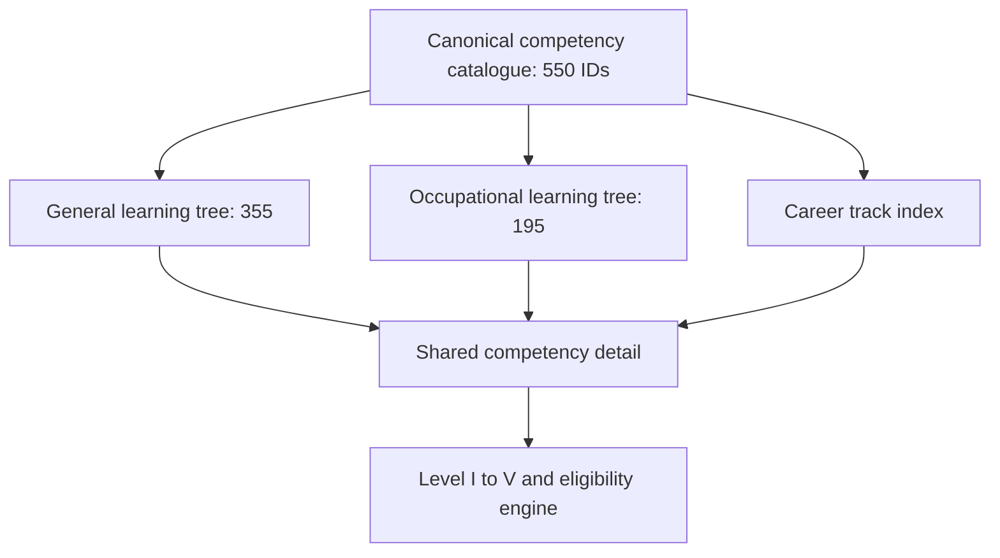
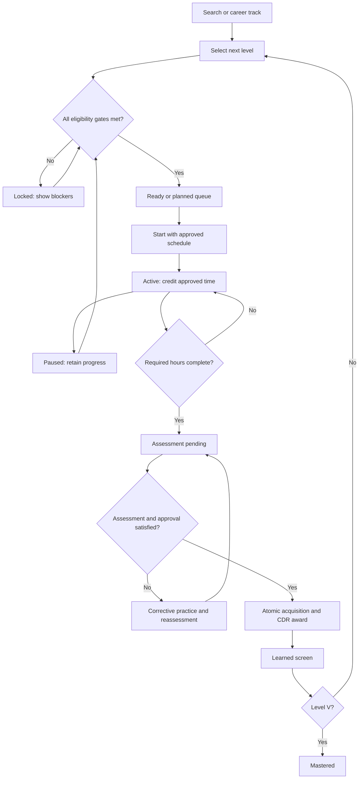
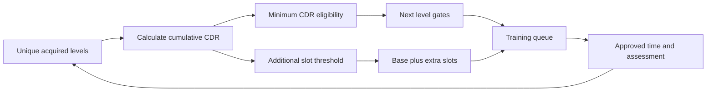

# BlackBox Character Companion — application design notes

Status: user requested standalone Windows and Android companion; name, UI organization and implementation details proposed under delegation. No software implemented. Existing tabletop rules remain authoritative in DESIGN-NOTES.md and SKILL-NOTES.md.

## Purpose and boundaries
Offline standalone character management and learning tracker between sessions; no GM host, account, cloud, subscription or internet required. Fourth application alongside GM Command, BlackBox OS (GM-hosted browser client) and Player Display. Share canonical rules data and calculation engines, not duplicate mechanics. Later optional local sync with GM Command; manual export/import must work independently. Printed books remain complete and playable without software.

## Character records
Multiple local characters; create/edit/import/export; avatar upload or default placeholder, local image storage. Identity, setting, campaign, age, description, background, attributes, derived stats, general skills, occupations and experience tiers, qualifications, authority, relationships, contacts, goals, conditions, health, fatigue, inventory, equipment condition, quantities, currency, notes and history. Starting occupation packages load from canonical data; merge highest level per ID, validate history, prerequisites, personal points and CDR. Package mapping and final character mechanics are dependencies, not completed. Editable records distinguish calculated fields from user inputs. Record provenance and corrections. Inventory supports ownership, location, accessibility, weight, consumables and condition as rules become final.

## Learning interface
Dashboard shows total CDR, next slot threshold, active slots, active projects, recent completions. Catalogue filters by general/occupational, introduction setting, branch, search, eligible/locked/learned; show description, current/next level, complexity, minimum CDR, award, hours, bonus, prerequisites, access, resources and missing requirements. Checkbox/start action opens confirmation, validates all gates and available slot, records target level, start timestamp, campaign time, training schedule, required hours, discount snapshot and expected finish. Unlimited planned queue; locked projects cannot accrue hours. Learned tab shows acquired level, next level upgrade button, eligibility and active upgrade progress. At V show mastered. Never sum overlapping bonuses or spend CDR.

## Clock and countdown — explicit design distinction
User requested date/time countdown that progresses between sessions and moves completed training to learned. Existing CCDD-12 requires actual in-world time, shared training budget and assessment; wall-clock passage alone cannot grant competency under standard rules. Provide campaign clock as default: GM-approved calendar/date, allocated training hours, manual advance or approved downtime interval; countdown estimates completion from schedule, progress = credited/required hours. Optional real-time synchronized campaign clock mode proposed for groups that explicitly agree that real elapsed time represents in-world downtime; choose approved start/end and daily training schedule, pause during unavailable periods, allocate shared hours across projects, never credit same time twice. Device clock is display/scheduling input, not authority; persist timestamps and ledger, handle timezone/DST, clock changes, reboot, offline resume, pause and correction. No background process required for correctness: recompute from saved approved intervals on opening. If campaign explicitly authorizes continuous training, countdown may run continuously only within agreed available hours. When timer reaches zero move to assessment pending, not automatically learned unless GM has preauthorized a specific assessment/completion condition and it is satisfied. Provide one-click confirm assessment, then atomically acquire level, award CDR, update slots and move to Learned. Optional automatic completion without assessment would be a separate house rule requiring explicit approval; not adopted. No real-time mode silently changes tabletop rules.

## Screens
Dashboard; Character Sheet; Learning Catalogue; Learning Queue; Learned Competencies; Inventory; Career History; Health & Conditions; Journal; Dice Tray; Settings. Mobile bottom navigation or compact menu, Windows sidebar; accessible text and progress labels. Show start date, expected finish, remaining credited hours, percent, pause/resume, blockers, assessment state and completion history. Optional local notifications when estimated training ends; no network required. Dice tray reuse subject to audit.

## Data and interoperability
Local authoritative character files, versioned canonical rules pack, stable competency IDs, local avatar assets, learning ledger and campaign clock settings. Atomic saves, backups, import validation, migration, no silent changes, conflict review when syncing. GM-approved campaign state wins only after explicit reconciliation; private notes stay private. Export printable character sheet and learning record; optional portable character bundle between Windows/Android. No platform/framework commitment until architecture review. Reuse same calculation engine and tests across companion and GM ecosystem; validate licensing/security.

## Delivery phases
1. Finalize catalogue, occupation packages, character rules and assessment mechanics; define shared schema and tests.
2. Standalone Windows/Android character creation, sheet, local storage and inventory.
3. Catalogue, eligibility engine, queue, campaign clock, countdown, progress and learned upgrades.
4. Export/backup, dice, conditions, journal, accessibility and offline testing.
5. Optional GM Command interoperability and local sync.
No mandatory digital dependency. Test thresholds, prerequisites, duplicate grants, simultaneous projects, clock jumps, offline restart, pause/resume, assessment, CDR award once, cross-setting migration and import conflicts.

## Publication charts
Reference MANUAL-CHARTS.md for learning progression, queue and eligibility charts; add companion screenshots only after implementation. Core explains manual tracking and optional companion; GM Handbook explains campaign clock and approval; Transition Handbook explains preservation of learning state.

# Implementation specification — Claude handoff

## 1. Scope, authority and preflight
Read AGENTS.md, foundation summary, DESIGN-NOTES.md (especially R01–R06, CCDD-01–19 and outstanding audit), SKILL-NOTES.md and MANUAL-CHARTS.md before implementation. Inspect existing repository tree and reusable dice/rules components before adding files. Do not assume any existing engine is implemented or compatible. Build a standalone Windows desktop and Android application; no GM server required. Proposed stack: Svelte 5 + TypeScript UI and Tauri 2/Rust shell, subject to repository and Android build compatibility audit; do not install or fork another project blindly. One shared domain engine, platform adapters for file access, notifications and image selection. No SQL requirement; prefer versioned local JSON files with atomic replacement and backups. No external services, telemetry, mandatory login or network calls. Do not invent missing tabletop rules, occupational grants, credentials, equipment statistics or career links. Mark provisional content and disable unsupported automation with an explanation; manual recording remains available. User owns final decisions.

## 2. Architecture and ownership
Suggested logical modules (adapt existing layout): rules-pack loader/validator; character domain; creation; competency eligibility; training scheduler; CDR/capacity; career graph/search; inventory; campaign clock; persistence/migration; export/import; UI; platform adapters. UI must not calculate authoritative CDR or mutate records directly. Domain commands validate then persist atomically; read models derive display. No duplicate rules in UI, Rust and TypeScript: choose one authoritative implementation and expose typed interfaces. No mandatory network, database or background worker. Build Windows and Android from shared UI/domain; test actual target devices. Keep rules pack separate from user saves. Source provenance includes document commit, schema version, rules version, draft flag. Never bundle copyrighted third-party material.

## 3. Canonical data contracts
Use stable IDs and integer levels 0–5. Proposed logical schema, not a mandated physical layout:
- RulesPack: id, version, schemaVersion, sourceCommit, competencies[], generalSkills[], occupations[], careerTracks[], equipment[], settings[], validationReport.
- Competency: id, name, aliases[], description, introductionSetting, tree, branchIds[], governingSkillId, complexity, levels[5], careerTrackIds[], occupationIds[], status, sourceRef. Level: number, minimumCDR, baseHours, creationCostTotal, cdrGain, cdrTotal, bonus, prerequisiteRoutes[], accessGates[], resources[], practice, assessment, mandatoryHours, credentialRefs. Prerequisite route is AND of required ID/minLevel pairs; multiple routes are OR only if explicitly authorized. Prior level is implicit, not included in efficiency average.
- Occupation: id, familyId, name, settingVariants, specializationIds, experienceTiers, packageRefs. Package: grants[{competencyId,level}], generalSkillAllocations, credentials, provenance, eligibility. No placeholder package masquerades as final.
- CareerTrack: id, name, aliases, description, familyIds, occupationIds, specializationIds, ordered milestones[{id,label,requirements}], competencyRefs[{id,recommendedLevel,role}], sourceRef, status. Multiple tracks may reference same competency. Career track is a planning view, not a class, bonus or qualification.
- Character: id, schemaVersion, rulesPackVersion, revision, identity, avatarRef, campaignId, setting, attributes (underlying/effective adjustments), generalSkills, occupations/history, credentials, competencies map {id,level,provenance}, personalCreationLedger, inventory, conditions, relationships, notes, clock, trainingProjects, trainingLedger, auditLog. CDR and slots are derived, not editable.
- TrainingProject: id, competencyId, targetLevel, state, selectedRoute, rulesVersion, mode, startedAtUTC, campaignStart, approvedScheduleId, requiredHoursSnapshot, discountSnapshot, creditedMinutes, assessmentEvidence, pauseReason, completedAt, completionEventId. Use integer minutes for ledger, convert hours for display; rounding per CCDD-12.
- Clock: mode, campaignDateTime, timezone, approvedIntervals, dailyTrainingBudget, lastReconciledUTC, revision. Ledger: projectId, intervalStart/end, creditedMinutes, source, approval, idempotencyKey. No overlapping credit for one character.
- Inventory item: id, optional catalogueId, label, quantity, unit, weight if known, condition, location/container, ownership, notes. Unknown stats remain unknown.
Validate unique IDs, references, level ranges, integer complexity, exact formula consistency, graph cycles at level nodes, no duplicate grants, no negative quantities, version compatibility. Parse the 550 Markdown records into a generated pack with reproducible tooling and validation; do not hand-copy values into components. Existing catalogue has generic descriptions and provisional prerequisite mapping; report semantic problems rather than silently repairing. Career/occupation mappings must be authored and reviewed; do not infer them from names as authoritative. Allow draft track browsing clearly labeled.

## 4. Search and career explorer (required)
Global search accessible from dashboard and all learning screens; dedicated catalogue search with instant local results. Search names, aliases, IDs, descriptions, occupation names, family, specialization, career track and governing general skill. Normalize case, whitespace, punctuation and diacritics; exact ID/name first, prefix next, token matches next, optional typo tolerance last. No remote search. Debounce UI input, keep responsive on Android; 550 entries should not require a server. Filters: General/Occupational, Core/SL/DZ introduction, career track, occupation/family, specialization, governing skill, complexity 1–7, current/target level, eligible, locked, queued, active, learned, mastered. Combine different filter dimensions with AND; multiple choices within one dimension OR. Clear all, show count, empty-state explanation, retain search on back navigation. Sort relevance, alphabetical, complexity, required CDR, hours or current level; deterministic ID tie-break. Search results show name/ID, tree, career tags, current/next level, CDR threshold, hours, eligibility and blocker summary. Clicking opens detail; never auto-start.
Career explorer: browse 14 occupation families, search a career or specialization, select a track, see overview, milestones, required vs recommended competencies, current vs target levels, prerequisites and missing resources. Expand prerequisite graph with cross-links; prevent recursive loops; list alternative routes only if authorized. Progress = completed required target-level milestones / total defined required milestones; label as track coverage, not character level or qualification. Empty/unmapped track shows unavailable mapping, not 100%. Recommended next steps are eligible unmet prerequisites/track targets, sorted by dependency order then ID; player can choose any eligible competency outside track. Queue selected next levels with preview; no automatic bulk acquisition. Example search 'chef' should find culinary track and associated competencies once mapping approved; 'G-001' returns exact record; 'culinary' matches names/aliases; occupation filter does not hide unrelated general skills unless selected. Locked entries remain visible with exact reasons and links to prerequisites. Career switch never removes learned skills.

## 5. Screen requirements and interactions
Dashboard: character switcher, avatar, setting/campaign, current CDR, next threshold and progress within band, active/capacity, training cards, recent completion, quick links, pending assessments. Empty states guide creation.
Character creation wizard: identity/avatar, setting, attributes, career history/experience, validated occupation packages, general skills, personal competency choices, equipment/contacts, review. Show remaining budgets and blockers; no grant twice, no self-funding CDR. Draft save/resume. If package missing, manual documented GM grant with provenance, not fabricated automatic package. Confirm finalization.
Character sheet: editable identity, portrait picker/crop optional, attributes, derived stats, skills, occupation, credentials, contacts, goals, health/conditions, notes. Show underlying vs effective values; no silent healing or auto-grants. Use manual fields for unresolved mechanics. Character avatar local copy with type/size validation, fallback placeholder, remove/replace.
Catalogue detail: description, governing skill, complexity, introduction setting, track links, five-level table, current level, next level, all gates with pass/fail/unknown, required resources, assessment, time estimate, reward. Start checkbox/button opens review; queue if unavailable. No skipping levels.
Queue: planned/locked/ready/active/paused/assessment pending/completed, reorder planned items, start, pause, resume, cancel with explicit progress-loss policy (default archive, retain ledger), view blockers, allocate hours, expected completion date and remaining duration. Active and assessment pending occupy slots unless paused. Show daily shared budget. Confirm destructive operations. Learned: searchable list, five segments with acquired levels filled and next active segment proportional to progress; next-level upgrade action, exact blockers, mastery at V, acquisition history. Completion appears immediately after valid assessment transaction.
Inventory: add/edit/remove/consume/transfer between local containers, quantity/condition/ownership, totals only for known weights, notes, filter/search; no invented carrying limits. Career history: dates, occupation, credentials, training evidence, track plans; no new starting grants after creation. Health/conditions: manual records and approved calculations only. Journal: local notes, contacts, goals, session history. Dice tray: inspect existing implementation, reuse only if verified. Settings: clock mode, timezone, training schedule, rules version, backups, import/export, accessibility, notifications, optional sync disabled until built.

## 6. Domain commands and formulas
Commands: createDraft, finalizeCharacter, updateIdentity, recordOccupationHistory, grantApprovedStartingPackage, queueLevel, startLevel, pauseLevel, resumeLevel, allocateTrainingInterval, reconcileClock, submitAssessment, confirmCompletion, archiveProject, correctRecord, importCharacter, exportCharacter. Each returns typed success or blockers, no partial mutation. Eligibility response includes priorLevel, CDR required/current/shortfall, each prerequisite actual/required, access, resources, supervision, slot, time, status and source version. Distinguish canQueue, canStart, canComplete. CDR=sum(100*c*(2^L-1)) over unique acquired IDs; no spending. Capacity base 2/3/4 plus largest threshold bonus from CCDD-12; career retraining subset 1/1/2. PCP cost difference of cumulative costs; CDR minimum from CCDD-19. Use exact canonical table values; cross-check generated formulas. Bonus highest applicable only. Discount snapshot from selected supporting prerequisites; Standard zero, Advanced/Simulation cap30%, ceil hours; mandatory hours not discounted. No automatic credit for queue or duplicate intervals. Completion transaction validates target still next, hours, practice, assessment and GM approval, writes level and event once, derives CDR and capacity, releases slot. Repeated event id is no-op; conflicting event rejected. Assessment failure retains hours. Corrections audited, pause affected projects without deleting progress. No silently changing historical training duration after pack update.

## 7. Clock and countdown implementation
Default campaign clock, optional approved real-time synchronized downtime as previously documented. Start captures UTC timestamp plus campaign date, schedule, daily allocation and snapshot duration. For real-time mode intersect elapsed interval with approved training windows, subtract already credited ledger intervals, distribute according to explicit allocation, cap at required minutes and shared daily budget. Never assume 24h/day or multiply time by slots. Forecast finish by walking future approved windows; if no schedule show unknown, not fabricated date. Display live countdown only as estimate, refresh from persisted ledger on launch/resume; app closed does not prevent valid approved elapsed credit. Clock rollback, forward jump beyond approved interval, timezone change, DST and reboot must not duplicate or invent credit; use UTC instants and local schedule timezone, request review for suspicious changes. Pause closes current interval; resume opens new interval after eligibility recheck. No carryover excess to next level. Notifications optional local and best effort, not completion authority. At zero move to assessment pending; if explicitly preauthorized assessment evidence is satisfied, complete automatically through same transaction. Otherwise player confirms assessment/GM approval. Do not implement unconditional wall-clock auto-learning without explicit rules change.
Example: 160h project, 104h credited, 4h/day approved =56h remaining, 14 training days; 65% progress. Two projects at 2h/day each use 4h total. Starting at 18,400 CDR, completing c4 III adds 1,600 to 20,000, no new slot until 25,000.

## 8. Persistence, privacy and portability
Use platform app-data directory; one versioned character record per character or equivalent atomic aggregate. Write temp, validate, atomic replace, retain last good backup; serialize concurrent commands. Store avatars by local relative asset ID, never arbitrary absolute paths in imports. Portable bundle includes manifest, character, assets, rules version and checksums; reject path traversal, oversized archives, invalid schema, duplicate IDs and unsupported versions. Import preview shows character identity, rules version, conflicts; copy or explicit replace, never silent merge. Export JSON and printable sheet/learning record; PDF optional after layout review. No cloud, telemetry or external AI. Local notifications request OS permission only when enabled. Sync later via GM local protocol, revision/conflict review, private journal excluded by default. Backup/restore tested on both platforms.

## 9. UI and accessibility
Responsive Windows sidebar and Android compact navigation; consistent Blackbox branding subject to approved assets. No fixed desktop-only widths; touch targets at least 44 logical pixels, keyboard navigation, screen-reader labels, scalable text, contrast, progress text in addition to color, no hover-only actions. Search accessible from keyboard and touch. Use virtualization only if profiling warrants; preserve focus and scroll. Show explicit loading/error/empty states, no inert buttons. Offline launch and all core functions with airplane mode. No fake data in production; fixture characters clearly marked.

## 10. Build order and acceptance gates
Phase A: inspect repo and dependencies; produce architecture decision and data validation report; confirm Windows/Android toolchain; generate canonical pack, report missing career mappings and unresolved rules. Phase B: domain engine + unit tests, persistence, migrations, creation and character sheet. Phase C: search, career explorer, catalogue, eligibility, queue, clock, learned upgrades. Phase D: inventory, history, conditions, journal, dice, export, notifications, accessibility. Phase E: Windows installer and Android APK, offline device tests, release notes. Optional GM sync separate phase. Each phase requires tests, no placeholder claiming completion, update docs and report blockers. Do not merge untested code or overwrite user data. No implementation of unresolved combat/health/economy mechanics without approved source.
Acceptance tests:
1. Pack has 550 unique IDs/2750 rows, counts 200/150,35/15,120/30; all formula values match source; dangling refs/cycles rejected.
2. Search exact ID, case-insensitive name, alias, occupation and career track; combined filters, clear, empty results, back navigation; unmapped track clearly unavailable.
3. CDR threshold boundary 14999/15000 for c4 IV; prior III required; sufficient CDR but missing prerequisite stays locked; no CDR deduction; duplicate grants max level.
4. CDR 9999/10000,24999/25000,399999/400000 capacity boundaries; career retraining subset; paused slot release.
5. Creation budgets 10/15/20, no self-funding, occupation grants provenance; missing package not invented.
6. Discount 0/10/20/30%, fractional surplus, unmet prereq, Standard zero, rounding; mandatory hours separate.
7. Shared budget 4h across two projects, no overlap, pause/resume, offline restart, clock rollback/forward, DST, expired approval, zero hours assessment pending.
8. Completion once, failure retains hours, no excess rollover, next level eligibility recomputed, mastery no upgrade.
9. Transition preserves acquired levels, CDR and progress; changes base slots; rechecks access.
10. Avatar upload/remove, inventory CRUD, save/reopen, backup/restore, import invalid archive rejection, Windows-to-Android portable bundle.
11. Airplane mode, Android process death, Windows restart, keyboard and touch, screen reader and large text; no network dependency.
12. Regression against manual charts and CCDD formulas; document actual test results, not assumed passes.

## 11. Outstanding dependencies and handoff
Career-track membership and occupation package data are not complete; catalogue semantic audit, individualized assessments, governing-skill audit, credential requirements, balance testing and several character subsystems remain unresolved. Build scaffolding and validated mechanics now, but mark draft data and do not present incomplete packages as official. Proposed stack, schema, UI details, search ranking and clock scheduling are implementation recommendations, not new tabletop mechanics. Claude must report conflicts with existing files before changing architecture; maintain a single rules source, preserve IDs and user-approved decisions. No code has been written by this document.

# Appendix A — Embedded learning mathematics and source tables

Reference snapshot from DESIGN-NOTES.md blob 5d1369c130ef5bba9f391060d1b0aefbf19db8dc. This is a convenience copy for implementation, not a second rules authority. CCDD-19 supersedes the older eligibility pseudocode wherever it omits minimum CDR. Real-time synchronized mode is an approved-downtime representation proposal, not unrestricted wall-clock advancement. Examples are illustrative, not verified occupation packages. Refresh against canonical sources before implementing.

### CCDD-12 Mathematical reference and implementation contract
Status: detailed specification of CCDD-01–11; numerical defaults remain provisional pending balance testing. This is the authoritative calculation reference, not a separate advancement mechanic. Earlier fixed specialization counts and fixed active-slot limits are superseded by CCDD-11/12. All percentages applied to D100 targets are percentage points unless explicitly a training-time percentage.

#### Variables and lookup tables
- E: setting BP, SL or DZ. P(E): personal creation budget 10,15,20. S(E): base active slots 2,3,4. R(E): career retraining project limit 1,1,2 (provisional).
- c: integer competency complexity 1–7. L: acquired integer level 0–5 (0 unlearned). O: highest level granted by documented starting occupational history, 0–5. A: underlying governing attribute; G: underlying general skill.
- H(c): default foundational training hours. Catalogue may override H or incremental hours with documented reason.
| c | Classification | H(c) hours | CDR base |
|---:|---|---:|---:|
| 1 | Basic | 4 | 100 |
| 2 | Elementary | 8 | 200 |
| 3 | Intermediate | 16 | 300 |
| 4 | Technical | 40 | 400 |
| 5 | Advanced | 80 | 500 |
| 6 | Professional | 160 | 600 |
| 7 | Specialist | 320 | 700 |
| L | Meaning | Bonus B(L) | Creation multiplier M(L) | CDR multiplier Q(L) | Incremental hour multiplier |
|---:|---|---:|---:|---:|---:|
| 0 | Unlearned | 0 | 0 | 0 | — |
| 1 | Fundamentals | 0 | 1 | 1 | 1 |
| 2 | Basic practical | 5 | 2 | 3 | 2 |
| 3 | Independent | 10 | 4 | 7 | 4 |
| 4 | Advanced | 15 | 8 | 15 | 8 |
| 5 | Mastery | 20 | 16 | 31 | 16 |
For L>=1, M(L)=2^(L-1), Q(L)=2^L-1. M(0)=Q(0)=0. B(L)=5×max(0,L−1); the total increases by five per level from II onward, and is applied once, not added to earlier level totals. No character levels.

#### Creation and occupational package merging
1. Establish campaign setting, concept, approved career history and experience tier. Resolve all justified occupational packages, including documented previous careers. No artificial occupational competency count or point ceiling. Do not grant every competency in a career tree; grant actual training. Qualifications and appointments recorded separately.
2. Canonicalize IDs; for duplicate competency i across occupational packages, O_i=max(granted levels), never sum. Include required prerequisite competencies or documented equivalent prior learning, with GM validation. No free occupational package after play starts.
3. Choose final starting L_i>=O_i, at most V. Personal cost p_i=c_i×[M(L_i)-M(O_i)]. Sum p_i over unique IDs. Require sum<=P(E). Unspent points expire at creation; no negative cost or refunds from lowering occupational levels. Personal IV/V require documented history and GM approval; all access gates and prerequisites must be satisfied, including any personally purchased prerequisite. This is not a cost for acquiring actual qualifications or authority.
4. Calculate general skills separately: G_i=floor(A_i/2)+occupational general skill allocation+personal general skill allocation, creation cap85, existing 100 personal general skill points remain provisional. No CDR or competency point conversion to general skill points. Calculate CDR and slots only after final package validation.
Example BP personal budget10: complexity1 Cooking II costs2; complexity2 Food Preservation I costs2; complexity3 Navigation II costs6; total10. If occupational Evidence Handling II (c3) upgraded to III, cost3×(4-2)=6, not12. Duplicate package grants II and IV resolve to IV free if both justified. A civilian cannot purchase a restricted competency merely by having enough points.

#### D100 task integration
For a possible nonroutine task, T=clamp(G+attribute adjustment+B(L)+difficulty+assistance+other distinct situational modifiers-adaptation penalty magnitude,1,99). Attribute adjustment follows R03 and earlier attribute rule; use one highest applicable competency bonus, never sum overlapping competencies. Difficulty and other modifiers are signed; do not subtract a signed negative deficit twice. Roll D100 using R01–R06. Raw attribute checks remain separate. Access to training is not identical to permission to perform a task; actual technical prerequisites and resources determine feasibility. Example Forensics60, Evidence Handling II +5 =>65; IV +15=>75; V +20=>80, before other modifiers. Difficult -20 and one helper +5 at IV =>60. CDR never enters this formula.

#### CDR and capacity
For each unique acquired competency i: V_i=100×c_i×Q(L_i). Total CDR=sum(V_i). Upgrade from old level a to b adds 100×c×[Q(b)-Q(a)]; sequential a→a+1 adds 100×c×2^a. Recompute from canonical records as authoritative; cached totals are derived only. No partial training credit, duplicate aliases, spending or transfer. Prior training counts at creation. Temporary access loss, adaptation penalties or injury do not reduce acquired levels/CDR. Corrections to erroneous records require audit and recalculation.
| Threshold inclusive | Extra slots |
|---:|---:|
| 0 | 0 |
| 10000 | 1 |
| 25000 | 2 |
| 50000 | 3 |
| 100000 | 4 |
| 200000 | 5 |
| 400000 | 6 |
K(CDR)=largest extra-slot value whose threshold<=CDR. Capacity=S(E)+K. Next threshold is smallest threshold>CDR; remaining=max(0,next-CDR); progress within current band=(CDR-current threshold)/(next-current threshold)×100; at maximum show no next threshold. Slots do not multiply hours. Career retraining projects are a subset of active projects, not extra slots (implementation clarification); active total<=capacity and active career retraining<=R(E). Unlimited queued and acquired competencies. A project targeting a single next level occupies one slot; assessment pending occupies slot unless paused. Paused projects retain progress and release slot. If correction reduces capacity, GM selects projects to pause, no loss of learning.
Police officer partial illustrative package:
| Competency | c | L | CDR |
|---|---:|---:|---:|
| Patrol Procedures | 3 | III | 2100 |
| Criminal Law | 4 | III | 2800 |
| Report Writing | 2 | III | 1400 |
| Evidence Handling | 3 | II | 900 |
| Investigative Interviewing | 4 | II | 1200 |
| Criminal Investigation | 4 | II | 1200 |
| Conflict De-escalation | 3 | III | 2100 |
| Police Communications | 2 | III | 1400 |
| First Aid | 2 | II | 600 |
Total=13700, K=1, BP capacity3, SL4, DZ5. Next threshold25000, remaining11300. This is a partial example, not a complete occupational profile. Advancing Criminal Investigation II→III adds 1600, total15300; no slot increase yet. At 24999 BP capacity3; at25000 capacity4. At400000 or above BP8/SL9/DZ10.

#### Eligibility and prerequisite efficiency
For next target level t=L+1<=5, evaluate level-specific access gates, required supporting competency IDs and minimum levels r_j, actual acquired levels a_j, learning resource, tools/facility, supervision, available slot and available in-world time. Every mandatory prerequisite must pass a_j>=r_j. Explicit alternative routes are evaluated separately; GM records selected valid route before training, no averaging across alternatives. No self-dependency or duplicate prerequisite ID; prior level of target competency is mandatory but excluded from efficiency average. A higher unrelated competency cannot compensate for an unmet requirement.
For n distinct supporting prerequisites in selected route, surplus_j=a_j-r_j. If any negative, locked. If n=0 or Standard mode, d=0. Otherwise d=min(0.30,0.10×floor(sum(surplus_j)/n)). Advanced/Simulation only. Use integer arithmetic if desired: discount percent=min(30,10×floor(sum/n)).
Unadjusted incremental hours U=H(c)×2^(t-1), or catalogue-specific incremental override. Adjusted H_required=max(1,ceil(U×(1-d))). Mandatory supervised practice, credential durations and assessments remain separate non-discountable requirements; catalogue may explicitly distinguish discountable hours from mandatory hours, in which case total=adjusted discountable hours+mandatory hours, no double counting. Snapshot selected route, mode and discount when project starts; pausing does not reset it. No retroactive reduction for newly acquired prerequisite levels. GM-approved correction recorded, not silent.
| Criminal Investigation target | Criminal Law | Evidence Handling | Interviewing |
|---|---:|---:|---:|
| I | II | I | I |
| II | II | II | II |
| III | III | II | II |
| IV | III | III | III |
| V | IV | IV | IV |
Illustrative c4, target III: U=40×4=160h. Actual IV/III/III against III/II/II gives surplus1/1/1, mean1, d10%, required144h. Actual V/IV/IV gives mean2, d20%,128h. Actual III/III/II gives mean1/3, d0%,160h. Actual V/I/V fails Evidence Handling despite high average, locked. Standard always160h if eligible. CDR gain1600 regardless of discount. No prerequisite example c1 level I requires4h, no discount.

#### Training time, progress and completion
Undiscounted cumulative hours from unlearned through L = H(c)×Q(L), only when no overrides. From acquired a through target b, sum incremental hours, or H(c)×[Q(b)-Q(a)] without overrides/discounts. Example c2 H8: 8/16/32/64/128 incremental; cumulative8/24/56/120/248. Level II→IV requires32+64=96h before discounts. Each level independently checks prerequisites.
For each in-world interval, available training time T_available determined by GM after sleep, duties, travel, recovery and other activities. Allocate h_i>=0 to eligible active projects, sum(h_i)<=T_available; no double credit for same time. Credited hours C_new=min(H_required,C_old+h_i); progress=100×C_new/H_required. Record actual time and evidence; excess hours do not automatically roll into next level, which must separately qualify. If hours complete but practice/assessment outstanding, show assessment pending, not acquired. Failed assessment preserves hours; corrective practice and reassessment required, exact assessment rules remain audit work. Completion requires hours, practice, assessment and applicable qualification requirements; GM confirms, set L=t, recompute CDR and capacity atomically, release slot. No automatic next-level start unless eligible and GM-approved. No real-world elapsed time.
Example 144h project with 30h credited:20.83%; four hours/day allocated entirely requires ceil(114/4)=29 additional training days, assuming all days available and no extra requirements. Two active projects allocated 2h each/day consume4h total, not8. Paused project retains30h. Transition preserves progress and original duration; recheck resources/access before resuming, not automatic cancellation. Setting changes base slots only; CDR unchanged.
Daily time guidelines in CCDD-11 are advisory, not guaranteed. Standard can record equivalent milestone/time blocks; no automatic completion by session count. Advanced hours and resources; Simulation detailed schedules, capacity and supervision. Training may supply ordinary general skill advancement evidence once; CDR not awarded for general skill increases or adaptation milestones alone.

#### Reference pseudocode (language-neutral)
```
M(l) = 0 if l == 0 else 2^(l-1)
Q(l) = 2^l - 1
personal_cost = sum(c[i] * (M(level[i]) - M(occupational[i])))
assert personal_cost <= budget[setting]
cdr = sum(100 * c[i] * Q(level[i]) for unique acquired IDs)
extra = max(k for k in 0..6 if cdr >= threshold[k])
capacity = base_slots[setting] + extra
eligible = all_access_gates AND all_prerequisites AND resources
           AND supervision_if_required AND free_slot AND available_time
if eligible:
    surplus = sum(actual[j]-required[j] for selected distinct supporting IDs)
    discount_pct = 0 if standard OR n == 0 else min(30,10*floor(surplus/n))
    hours = max(1,ceil(base_incremental_hours*(100-discount_pct)/100))
    snapshot(hours, discount_pct, route, mode)
credit = min(hours, prior_credit + approved_allocated_hours)
if credit == hours AND practice_complete AND assessment_passed AND GM_approved:
    acquire_next_level()
    recompute_cdr_and_capacity()
    release_slot()
```
Mandatory nondiscountable hours and qualification gates follow prose above; pseudocode is reference, not production code.

#### Data, validation and publication requirements
Canonical catalogue: stable ID, label, complexity, governing skill, level definitions, per-level prerequisites/access routes, hours/overrides, resources, practice/assessment and qualification links, track/path memberships, era availability, aliases. Character: acquired levels and provenance, occupational package history, personal creation allocation, credentials/authority, active/queued/paused projects, time ledger, assessment evidence, derived CDR/capacity, version. Validate integer levels/complexity, unique IDs, prerequisite graph at competency-level nodes, valid alternative routes, nonnegative hours and costs, no over-allocation, no duplicate credit. Store formula version and catalogue version; migration must preserve earned levels and record any recalculation, never silently change progress. Print tables and worked examples in Core; GM Handbook adjudication; Transition Handbook continuity; software uses same canonical calculations.
Required tests: level0/V boundaries; complexity1/7; personal budget exact/exceeded and occupational upgrade; duplicate package merge; CDR 9999/10000,24999/25000,399999/400000; no prerequisites, fractional surplus, unmet gate, 30% cap, Standard discount zero; time rounding, pause/resume, shared time, assessment failure, qualification not waived; setting transition; loss of access; homebrew aliases/cycles; D100 clamp and nonstacking. Numerical examples are illustrative, not empirical education durations. No claim of completed catalogue, assessment design, balance playtest or software implementation.


### CCDD-19 Cumulative CDR eligibility (user approved)
| Complexity | I | II | III | IV | V |
|---|---:|---:|---:|---:|---:|
| 1 | 0 | 100 | 500 | 1500 | 3000 |
| 2 | 0 | 200 | 1000 | 3000 | 6000 |
| 3 | 0 | 500 | 2500 | 7500 | 15000 |
| 4 | 0 | 1000 | 5000 | 15000 | 30000 |
| 5 | 2500 | 5000 | 10000 | 30000 | 60000 |
| 6 | 5000 | 10000 | 25000 | 60000 | 120000 |
| 7 | 10000 | 25000 | 50000 | 120000 | 250000 |

CDR is non-spendable, cumulative across unique completed levels and settings. Before activating target level require current character CDR >= matrix[c-1][target-1], prior level, supporting prerequisites, resources, access, supervision, slot and available time. Queue locked projects without credit. Award existing incremental CDR only on assessed completion; no spending, self-funding, partial credit or automatic acquisition. Existing CCDD-12 formulas unchanged. Documented occupational starting grants reflect prior education and are not retroactively gated; personal creation purchases use already validated grants and earlier eligible purchases, not target award (delegated implementation default, review in creation audit). Existing acquired levels retained. On correction reducing CDR below active target threshold pause pending eligibility; preserve credited hours (delegated default). Individual exceptions require documented approval. Thresholds require playtest for relevant career reachability, especially specialist entry and mastery. All 2750 catalogue rows carry thresholds. Manual chart reference: [MANUAL-CHARTS.md](MANUAL-CHARTS.md).


## A.1 Combined eligibility pseudocode (CCDD-12 plus CCDD-19)
```text
target = acquired_level + 1
can_start = target <= 5 AND current_CDR >= minimum_CDR[complexity,target]
            AND prior_level_met AND supporting_prerequisite_route_met
            AND access_met AND resources_met AND supervision_met
            AND free_slot AND retraining_subset_limit_met AND available_time
# Queueing is not acquisition; no CDR deduction.
# Completion requires approved hours, practice, assessment and applicable gates.
```

# Appendix B — Chart source data and layout references
Snapshot from MANUAL-CHARTS.md blob 9ef955076ccff66dfd0952c9a1ddc99a2aff2067. Preserve for UI and publication; not new rules.

## MC-01 Catalogue coverage (Core, Signal Lost, Dead Zone)
| Publication | New general | New occupational | New total | Cumulative total |
|---|---:|---:|---:|---:|
| Core | 200 | 150 | 350 | 350 |
| Signal Lost | 35 | 15 | 50 | 400 |
| Dead Zone | 120 | 30 | 150 | 550 |
| Total | 355 | 195 | 550 | 550 |

Visual: stacked horizontal bars by publication introduction, distinguish categories with labels/patterns, not color alone. 2750 proficiency stages.

## MC-02 Progression and proficiency (Core)
| Level | Meaning | Bonus | PCP multiplier | Incremental hour multiplier | Cumulative CDR multiplier |
|---|---|---:|---:|---:|---:|
| I | Fundamentals | 0 | 1 | 1 | 1 |
| II | Basic practical | +5 | 2 | 2 | 3 |
| III | Independent | +10 | 4 | 4 | 7 |
| IV | Advanced | +15 | 8 | 8 | 15 |
| V | Mastery | +20 | 16 | 16 | 31 |

## MC-03 Training hours by complexity (Core)
| Complexity | I | II | III | IV | V | Total |
|---|---:|---:|---:|---:|---:|---:|
| 1 | 4 | 8 | 16 | 32 | 64 | 124 |
| 2 | 8 | 16 | 32 | 64 | 128 | 248 |
| 3 | 16 | 32 | 64 | 128 | 256 | 496 |
| 4 | 40 | 80 | 160 | 320 | 640 | 1240 |
| 5 | 80 | 160 | 320 | 640 | 1280 | 2480 |
| 6 | 160 | 320 | 640 | 1280 | 2560 | 4960 |
| 7 | 320 | 640 | 1280 | 2560 | 5120 | 9920 |

Visual: stepped bars for incremental hours; distinguish cumulative total. Daily training calculator: ceil(incremental hours / allocated daily hours), excluding additional requirements; use 1,2,4,8 hours/day examples. Do not imply elapsed real-world time.

## MC-04 Complexity 4 worked example (Core)
| Level | Minimum character CDR | Hours | PCP total | CDR gain | Competency CDR total | Bonus |
|---|---:|---:|---:|---:|---:|---:|
| I | 0 | 40 | 4 | 400 | 400 | +0 |
| II | 1000 | 80 | 8 | 800 | 1200 | +5 |
| III | 5000 | 160 | 16 | 1600 | 2800 | +10 |
| IV | 15000 | 320 | 32 | 3200 | 6000 | +15 |
| V | 30000 | 640 | 64 | 6400 | 12400 | +20 |

Visual: five-step progression, threshold distinct from reward. 1240 hours and 12400 CDR earned in this competency; 30000 character CDR needed before V. Blacksmithing example subject to actual catalogue rating verification.

## MC-05 Learning capacity by setting (Core/Transition)
| Setting | Personal creation PCP | Base slots | Maximum slots | Career retraining subset |
|---|---:|---:|---:|---:|
| Core | 10 | 2 | 8 | 1 |
| Signal Lost | 15 | 3 | 9 | 1 |
| Dead Zone | 20 | 4 | 10 | 2 |

## MC-06 Learning queue and eligibility flow (Core/GM Handbook)
Planned → check prior level, accumulated CDR, prerequisites, access, resources, supervision → locked if unmet; otherwise ready → active when slot and time available → assessment pending after hours → completed after assessment and GM approval → award CDR and recalculate capacity. Pause/resume preserves hours. Illustrative queue: 18400 CDR, Core 3 slots; complexity-4 project III 104/160 hours (65%), complexity-2 project II 24/16 is invalid; use 12/16 (75%), complexity-3 project II 8/32 (25%). Queued projects have no credit until active. Use progress bars with numeric labels. No automatic acquisition or spending.

## MC-07 Leadership transition example (Transition Handbook)
| Stage | Underlying skill | Context penalty | Effective before other modifiers |
|---|---:|---:|---:|
| Core | 75 | 0 | 75 |
| Signal Lost | 75 | -5 | 70 |
| Dead Zone | 75 | -10 | 65 |
| First adaptation milestone | 75 | -5 | 70 |
| Second adaptation milestone | 75 | 0 | 75 |

Adaptation mechanics remain subject to outstanding audit. Visual: line graph showing underlying constant and effective contextual recovery.


## B.1 Training days calculator (undiscounted complexity 4)
| Level | Hours | 1h/day | 2h/day | 4h/day | 8h/day |
|---|---:|---:|---:|---:|---:|
| I | 40 | 40 | 20 | 10 | 5 |
| II | 80 | 80 | 40 | 20 | 10 |
| III | 160 | 160 | 80 | 40 | 20 |
| IV | 320 | 320 | 160 | 80 | 40 |
| V | 640 | 640 | 320 | 160 | 80 |
Total 1240 hours; excludes prerequisite training, assessment and interruptions. Calendar finish requires actual approved schedule.

# Appendix C — Learning system diagrams and interface wireframes
Mermaid diagrams are editable source, not final artwork. All screen examples are illustrative and must use canonical data in production.

## C.1 Two learning trees, one catalogue

## C.2 Learning state and completion

## C.3 Cumulative points and slots

## C.4 Screen wireframes
```text
DASHBOARD
[Avatar] Character / occupation / setting
CDR 18,400 | Next threshold 25,000 | Remaining 6,600
Band progress [########----] 56% (8,400 / 15,000)
Active 2/3 | Pending assessments | Recent completions
[Search skills or career tracks] [Character] [Inventory]

CATALOGUE / CAREER EXPLORER
[Search name, ID, occupation, career track]
[General / Occupational] [Setting] [Eligibility] [More filters]
Result: name | current/next level | CDR threshold | hours | blockers
Career track: required targets met 3/5 (60%)
  Target A III: acquired IV [met]
  Target B III: acquired III [met]
  Target C III: acquired III [met]
  Target D III: acquired I [next level II]
  Target E III: acquired II [next level III]
[View prerequisites] [Queue selected eligible next levels]

ACTIVE LEARNING
Complexity 4, Level III | 104/160h [########-----] 65%
Remaining 56h | +1,600 CDR on completion
Start date | Approved schedule | Estimated finish | Pause
At 4h/day: 14 training days remaining (if entire budget allocated).
Second project: 4/16h [###---------] 25%
Shared daily budget shown separately; slots do not multiply hours.

LEARNED
Competency A: II acquired, III active at 65%
[I full][II full][III 65%][IV empty][V empty]
Competency B: III acquired [Upgrade IV / eligibility]
Competency C: V acquired [Mastered]
[Search] [Career filter] [History]

CHARACTER SHEET
[Avatar / upload] Identity | Occupation | Campaign | Setting
STR CON DEX INT PER WIL PRE
Health | Stamina | CDR | Slots
General skills | Competencies | Inventory | Credentials
Conditions | Finances | Contacts | Journal
```
## C.5 Visual production requirements
Use the complexity-4 table in B for stepped training-hour bars (40,80,160,320,640), five-level proficiency segments and distinct minimum-CDR versus earned-CDR labels. Use catalogue counts for stacked bars 350,400,550. Use MC-07 for underlying Leadership 75 constant versus effective 75,70,65,70,75; adaptation remains audit-dependent. Use accessible numeric labels and no color-only status. Search and career explorer must expose missing prerequisites and exact eligibility, not simply a lock icon. No illustrative ID/name pair or career target may be treated as canonical without validation.

## Appendix D — CCDD-20 modifier implementation amendment
User-approved competency modifier: B(L)=5×max(0,L−1), for integer L=0–5. Level I grants no D100 bonus but retains CDR, training and prerequisite value. Each level II–V adds +5 percentage points to the same competency's total (0/5/10/15/20 for I–V). Apply only the highest relevant competency total once per check; never sum separate competencies or previous level totals, never permanently increase underlying general skill. Final possible D100 target remains capped at 99. All other learning mechanics unchanged.

Engine: validate integer level 0–5; bonus = 5 * max(0, level - 1); choose max applicable bonus (default 0). Display underlying skill, contextual modifier and effective target separately. Catalogue level I displays +0. Learned upgrade preview shows +5 incremental and new total for II–V. Do not persist bonus as an increase to general skill. Recalculate derived displays from acquired levels after rules-pack migration; retain levels, CDR and training history. Test levels 0–5 => 0,0,5,10,15,20; base60 => 60,60,65,70,75,80; two relevant bonuses +10 and +15 => +15; base90 plus20 =>99 for possible nonroutine task. Appendix A/B snapshots amended for CCDD-20; canonical DESIGN-NOTES.md controls.
